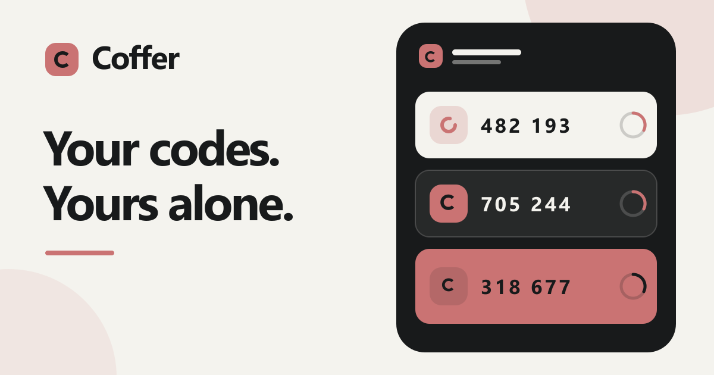

 [](https://github.com/caglaryalcin/Coffer/releases)

🌐 [Chrome Extension](https://chromewebstore.google.com/detail/coffer/ajekhlpjkcohkdedhkdjkadilecboimd)

🌐 [Firefox Extension](https://addons.mozilla.org/tr/firefox/addon/coffer/)

# Coffer

Coffer is a self-hosted, multi-user authenticator vault. It generates TOTP and HOTP
codes in the browser and encrypts each user's vault before storing it on the
server. It also supports QR imports, groups, backups, and 2FAS transfers.


**Mobile Responsive**


## Features

- Multi-user, browser-encrypted vaults
- Optional password recovery using a user-held recovery key plus a 15-minute email link; the server never receives the recovery key or decrypted vault data
- TOTP and HOTP generation with QR and manual account setup
- HOTP counters advance explicitly with Next code and are saved in the encrypted vault before copying; copying alone does not advance them
- HOTP import/export through Coffer backups, 2FAS, 2FAuth imports, and OTPAuth links (counter range: 0–9,007,199,254,740,991)
- Existing TOTP vaults and backups remain supported; Steam Guard is not supported


- Groups, favorites, archive, search, and bulk actions
- Automatic local service logos and custom logo uploads


- Encrypted backups plus 2fas, 2fAuth, and OTPAuth transfers


  
- Responsive light and dark interfaces


## Docker

GitHub Actions publishes the same **AMD64 and ARM64** image and tags to both
registries:

| Registry | Image |
| --- | --- |
| GitHub Container Registry (GHCR) | `ghcr.io/caglaryalcin/coffer:latest` |
| Docker Hub | `caglaryalcin/coffer:latest` |

Choose one of the following commands. Both use the same persistent `coffer-data`
volume.

From GitHub Container Registry:

```bash
docker volume create coffer-data
docker run -d --name coffer --init --restart unless-stopped -p 3000:3000 -v coffer-data:/app/data ghcr.io/caglaryalcin/coffer:latest
```

From Docker Hub:

```bash
docker volume create coffer-data
docker run -d --name coffer --init --restart unless-stopped -p 3000:3000 -v coffer-data:/app/data caglaryalcin/coffer:latest
```

Open [http://localhost:3000](http://localhost:3000). The `coffer-data` volume
keeps encrypted vault data across container restarts and replacements.

| Release | Image tags in both registries |
| --- | --- |
| For example, `v1.16.3` | `v1.16.3`, `1.16.3`, `1.16`, `1`, `latest` |

Images are published when a GitHub Release is published or when the container
publishing workflow is run manually for an existing stable release tag. Pushes
to `main` do not publish images. To pin a version, replace `:latest` with a
specific tag, such as `:1.16.3`, in either command.

The included `docker-compose.yml` builds locally. To use a prebuilt image,
replace `services.app.build` with `image: ghcr.io/caglaryalcin/coffer:latest` or
`image: caglaryalcin/coffer:latest`, then run `docker compose up -d`.

## Environment variables

| Variable | Default | Purpose |
| --- | --- | --- |
| `COFFER_DATA_DIR` | `data` (`/app/data` in Docker) | Directory containing encrypted vault files. Mount persistent storage here. |
| `COFFER_TRUST_PROXY` | `0` | Set to `1` only behind a trusted reverse proxy so Coffer accepts forwarded origin, protocol, and client IP headers. |
| `VINEXT_TRUSTED_HOSTS` | Empty | Comma-separated public `host[:port]` allowlist, such as `coffer.example.com`. Recommended for HTTPS reverse-proxy deployments. |
| `COFFER_OIDC_ISSUER_URL` | Empty | OIDC issuer URL. Setting this enables OIDC sign-in. |
| `COFFER_OIDC_CLIENT_ID` | Empty | OIDC client ID registered for Coffer. |
| `COFFER_OIDC_CLIENT_SECRET` | Empty | OIDC client secret. May be omitted for a public client that accepts PKCE. |
| `COFFER_OIDC_CLIENT_AUTH_METHOD` | `client_secret_basic` with a secret; otherwise `none` | Token endpoint authentication: `client_secret_basic`, `client_secret_post`, or `none`. |
| `COFFER_OIDC_PROVIDER_NAME` | `OpenID Connect` | Provider name shown on the sign-in button. |
| `COFFER_OIDC_SCOPES` | `openid email profile` | Space-separated OIDC scopes. `openid` and `email` are always requested. |
| `COFFER_OIDC_REDIRECT_URI` | Derived from request | Explicit callback URL, for example `https://coffer.example.com/api/auth/oidc/callback`. |
| `COFFER_PUBLIC_URL` | Derived from request | Public Coffer origin used in password recovery emails, for example `https://coffer.example.com`. Set this explicitly in production. |
| `COFFER_SMTP_HOST` | Empty | SMTP server hostname. Password recovery is enabled when this and `COFFER_SMTP_FROM` are valid. |
| `COFFER_SMTP_PORT` | `587` | SMTP server port. |
| `COFFER_SMTP_SECURE` | `0` | Set to `1` for implicit TLS, usually on port 465. Port 587 uses STARTTLS. |
| `COFFER_SMTP_USER` | Empty | Optional SMTP username. Must be paired with `COFFER_SMTP_PASSWORD`. |
| `COFFER_SMTP_PASSWORD` | Empty | Optional SMTP password. Must be paired with `COFFER_SMTP_USER`. |
| `COFFER_SMTP_FROM` | Empty | Sender address used for recovery emails, for example `Coffer <no-reply@example.com>`. |
| `COFFER_RECOVERY_DEV_MODE` | `0` | Development only. Set to `1` outside production to show the recovery link in the UI without SMTP. Never use in production. |
| `HOST` | `0.0.0.0` in Docker | Address the application server listens on. |
| `PORT` | `3000` | Application server port inside the container. |
| `NODE_ENV` | `production` in Docker | Node.js runtime mode. |
| `APP_HOST` | `127.0.0.1` | Docker Compose host address used for the published port. |
| `APP_PORT` | `3000` | Docker Compose host port. |

All `COFFER_*` settings, `VINEXT_TRUSTED_HOSTS`, `HOST`, `PORT`, and `NODE_ENV`
are container environment variables. `APP_HOST` and `APP_PORT` are Docker
Compose substitutions. When using Compose, add `VINEXT_TRUSTED_HOSTS` to
`services.app.environment`; placing it only in `.env` does not pass it into the
container.

### OpenID Connect

Register Coffer as an OIDC web application using the Authorization Code flow.
Add this callback URL to the provider:


```text
https://coffer.example.com/api/auth/oidc/callback
```

Then configure at least `COFFER_OIDC_ISSUER_URL` and `COFFER_OIDC_CLIENT_ID`.
Most confidential clients also require `COFFER_OIDC_CLIENT_SECRET`; use
`COFFER_OIDC_CLIENT_AUTH_METHOD` if the provider requires `client_secret_post`.
The provider must return an `email` claim, either in the ID token or from
UserInfo. Identities explicitly marked with `email_verified: false` are
rejected.
For reverse-proxy deployments, set `COFFER_OIDC_REDIRECT_URI` explicitly or
enable `COFFER_TRUST_PROXY=1` and ensure the proxy overwrites the forwarded host
and protocol headers.

After signing in to a vault, the same values can be managed from **Settings →
OpenID Connect**. Settings saved in the UI take precedence over environment
variables and are written atomically to
`COFFER_DATA_DIR/oidc-settings.json` (`/app/data/oidc-settings.json` in the
container). The data directory is restricted to mode `0700` and the settings
file to `0600` where the platform supports POSIX permissions. The client secret
is never returned by the settings API or rendered back into the browser. Keep
the mounted data volume private, encrypted at the Kubernetes storage layer when
available, and included in protected backups.

OIDC authenticates the account identity; the vault password still encrypts and
decrypts data only in the browser. Existing accounts are matched by their
normalized email address, so users can adopt OIDC without migrating vault data.
Browser extensions continue to use the existing email-and-vault-password flow.
OIDC authorization flows and sessions currently live in process memory. Run one
replica, or configure load-balancer affinity; pod restarts require users to sign
in to the identity provider again.

### Password recovery

Configure SMTP with the `COFFER_SMTP_*` environment variables or from
**Settings → Email delivery**, then each existing or new user can opt in from
**Settings → Security → Account recovery**. Settings saved in the interface are
stored in `COFFER_DATA_DIR/smtp-settings.json` and take priority over every SMTP
environment variable. The SMTP password is never returned by the settings API
or rendered back into the browser. Coffer asks for the current vault password and
creates a printable recovery key in the browser. The server stores only an
encrypted envelope and a verifier; it cannot reconstruct the recovery key or
decrypt the vault.

A forgotten-password reset requires both the emailed link and the saved recovery
key. Recovery links expire after 15 minutes, are rate-limited, and are kept only
in the running server process. Run one replica or use load-balancer affinity;
restarting the process invalidates outstanding links. A successful reset revokes
existing sessions and invalidates the recovery key, so the user must create a new
one after signing in.

Recovery is optional and backward compatible. Existing accounts keep working
without migration, but an account that did not create a recovery key before the
password was lost cannot be recovered retroactively. Vault backups remain the
last-resort recovery path.

For HTTPS behind a reverse proxy, set both `COFFER_TRUST_PROXY=1` and
`VINEXT_TRUSTED_HOSTS` to the public hostname. The proxy must overwrite and
forward `X-Forwarded-Proto` and `X-Forwarded-Host`; the application backend
should not be exposed directly when proxy trust is enabled. Production browser
access requires HTTPS because vault encryption uses Web Crypto; `localhost` is
the development exception.

> Passwords can be reset only when account recovery was enabled in advance and
> the user still has both the recovery key and access to the account email. Keep
> a protected backup of encrypted vault data as well.
